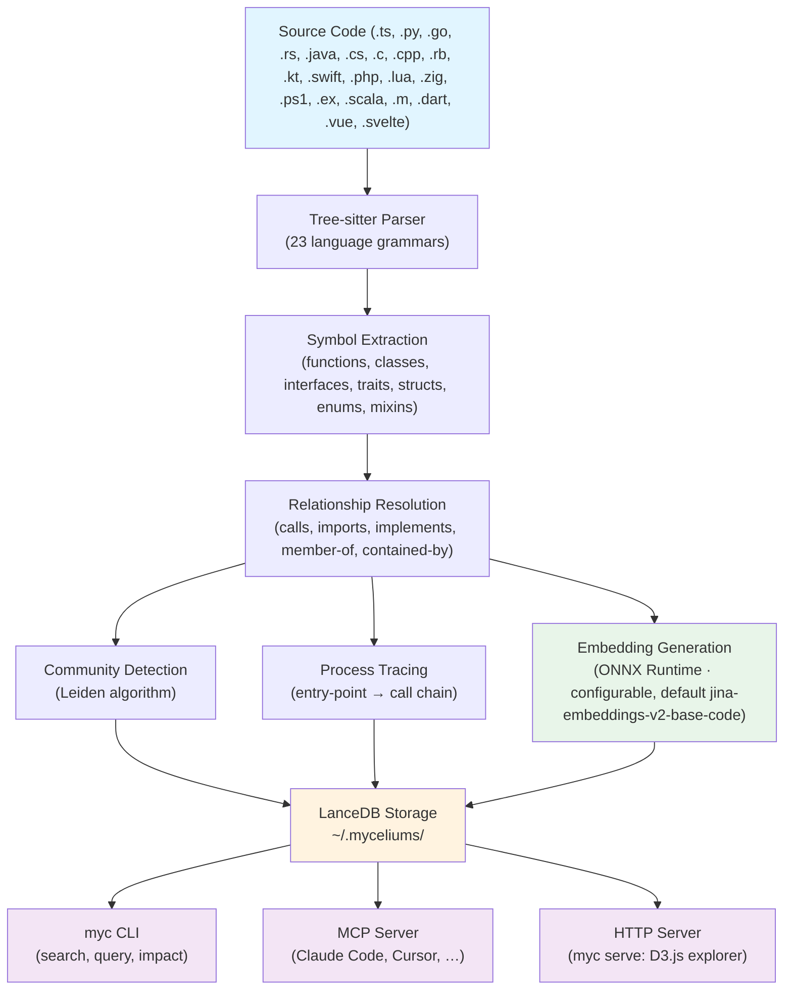

<p align="center">
  
</p>

# Myceliums

[](https://github.com/marcmantei/myceliums/actions)
[](https://crates.io/crates/myc)
[](LICENSE)

**The code knowledge graph that gives AI agents structural understanding — not just text search.**

Myceliums parses your code into a queryable graph of symbols, call chains, communities, and execution flows, and serves it to AI agents over MCP and to you on the command line. Whether that makes an agent more accurate, cheaper or faster is measured rather than assumed — see [Does it help an agent?](#does-it-help-an-agent).

```
$ myc analyze ./my-project

Analyzing /home/dev/my-project ...
  Symbols:       1,247
  Files:          312
  Relationships: 4,891
  Communities:     23
  Processes:       47

Repository ID: my-project-a1b2c3
```

---

## Why Myceliums?

| Text search alone | With Myceliums |
|---|---|
| Finds the lines where a name appears | Also knows the symbol each line belongs to and what calls what (scopes, imports and declared types; no type inference) |
| Reads whole files for context | Returns a symbol's signature, callers and callees |
| No notion of the code's structure | Community detection groups related code |
| Impact analysis by hand | `myc impact` traces the blast radius of a diff (with confidence flags) |

These are capabilities, not measured outcomes. Measured on 30 code-understanding questions, a Claude Code agent with grep and file reading alone answered as accurately as with myceliums added, and never called myceliums when it had it. On 20 harder multi-hop questions, with the current core tools loaded up front, it called myceliums in 80-100 % of sessions depending on the integration, without a measurable change in accuracy, tokens or cost between integrations: [results](#does-it-help-an-agent).

### Key capabilities

- **23 languages** — TypeScript, JavaScript, Python, Go, Rust, Java, C#, C, C++, Ruby, Kotlin, Swift, PHP, TSX, Lua, Zig, PowerShell, Elixir, Scala, Objective-C, Dart, Vue, Svelte
- **Content files** — Markdown, MDX, and plain text indexed alongside code (headings as Section symbols, links as References edges)
- **Cypher queries** — Query your codebase like a database: `MATCH (s)-[:CALLS]->(t) RETURN t.name`
- **Token-optimized reviews** — `get_review_context` returns minimal structural summaries (signatures, callers, callees) instead of full source
- **Interactive visualization** — `myc serve` launches a D3.js force-directed graph explorer in your browser
- **Community detection** — Leiden algorithm automatically discovers code clusters and architectural boundaries
- **Process tracing** — Maps execution flows from entry points through entire call chains
- **Impact detection** — Traces which symbols are affected by your current git diff
- **Symbol rename** — Preview cross-codebase renames before applying
- **Fully local** — No cloud, no telemetry, no API keys. Data stays on your machine.

---

## Quick start

```bash
# Install
cargo install myc

# Analyze your project
cd my-project && myc analyze .

# Set up Claude Code integration for this project (MCP server, hooks,
# CLAUDE.md routing block, code-explorer subagent; --scope user for all projects)
myc setup-claude

# Start Claude Code — myceliums is ready
claude
```

Claude Code can now call the knowledge-graph tools. Whether it does is up to the model: in the [agent benchmark](#does-it-help-an-agent) pilot, with the old 54 deferred tools, it never did; with the 9 core tools loaded up front it called them in 80 % of sessions with the MCP server alone and in 100 % with the routing block and hooks that `myc setup-claude` installs (it also installs a subagent, which the agent did not use); see [Integrating with agents](#integrating-with-agents).

For the full walkthrough, see the [Getting Started guide](docs/getting-started.md).

```bash
# Search symbols
myc search "authentication"

# Query the graph with Cypher
myc query 'MATCH (s)-[:CALLS]->(t) WHERE s.name = "login" RETURN t.name'

# Trace execution flows
myc processes my-project --entry "handlePayment"

# Check impact of your changes
myc impact

# Who calls a function / what a change to it breaks (compact, for agents)
myc callers parse_query
myc impact parse_query

# Launch interactive graph visualization
myc serve
```

---

## Supported languages

<details>
<summary><strong>23 languages supported (click to expand)</strong></summary>

| Language | Parser | Extracts |
|---|---|---|
| TypeScript | `tree-sitter-typescript` | functions, classes, interfaces, type aliases, enums, imports |
| TSX | `tree-sitter-typescript` | same as TypeScript + JSX components |
| JavaScript | `tree-sitter-javascript` | functions, classes, arrow functions, CommonJS/ESM imports |
| Python | `tree-sitter-python` | functions, classes, decorators, imports |
| Go | `tree-sitter-go` | functions, methods (with receivers), structs, interfaces, goroutines |
| Rust | `tree-sitter-rust` | functions, structs, enums, traits, impl blocks, macros, use trees |
| Java | `tree-sitter-java` | classes, interfaces, enums, records, annotations, generics |
| C# | `tree-sitter-c-sharp` | classes, structs, records, interfaces, properties, namespaces |
| C | `tree-sitter-c` | functions, structs, unions, enums, typedefs, macros, #include |
| C++ | `tree-sitter-cpp` | classes, templates, namespaces, operator overloads, using declarations |
| Ruby | `tree-sitter-ruby` | classes, modules, methods, mixins (include/extend/prepend) |
| Kotlin | `tree-sitter-kotlin-ng` | data/sealed classes, objects, companion objects, extension functions |
| Swift | `tree-sitter-swift` | classes, structs, protocols, enums, extensions, actors |
| PHP | `tree-sitter-php` | classes, interfaces, traits, enums, namespaces, use statements |
| Lua | `tree-sitter-lua` | functions, tables (as modules), require statements |
| Zig | `tree-sitter-zig` | functions, structs, enums, imports |
| PowerShell | `tree-sitter-powershell` | functions, command invocations, module imports |
| Elixir | `tree-sitter-elixir` | modules, functions, macros, use/import/require directives |
| Scala | `tree-sitter-scala` | classes, objects, traits, functions, import statements |
| Objective-C | `tree-sitter-objc` | classes (interfaces), methods, protocols, #import directives |
| Dart | `tree-sitter-dart` | classes, functions, methods, mixins, extensions, enums, imports |
| Vue | `tree-sitter-typescript` (script block) | functions, classes, interfaces, type aliases, enums, imports from `<script>` blocks |
| Svelte | `tree-sitter-typescript` (script block) | functions, classes, interfaces, type aliases, enums, imports from `<script>` blocks |

</details>

**Call resolution (CALLS edges).** For **Python, TypeScript/JavaScript (with Vue and Svelte script blocks), Go, Rust and Java**, a call is resolved the way the language binds it: bare calls through the caller's scopes and imports, method calls through the receiver's declared type, and only an untyped receiver by method name (measured on the hand-labelled fixtures: precision 1.00, recall 0.996; on 52 call sites sampled from four real repositories: 0.95 and 0.95). **Every other language is still matched by name** — nearest scope first (file, imports, directory), with the caller found by position and never across language families — and its accuracy is not measured. Details and limits: [call-resolution-limitations](docs/guides/call-resolution-limitations.md).

**Content files** (built-in line parser, no tree-sitter):

<details>
<summary><strong>Markdown and text files (click to expand)</strong></summary>

| Content type | Extensions | Extracts |
|---|---|---|
| Markdown | `.md`, `.markdown` | headings (H1–H6) as Section symbols, `[text](path)` links as References edges |
| MDX | `.mdx` | same as Markdown; JSX blocks treated as prose |
| Plain text | `.txt` | Document symbol only |
| PDF | `.pdf` | converted to Markdown via `opendataloader-pdf`, then parsed as Markdown (requires `pdf` feature flag and `opendataloader-pdf` CLI) |

</details>

---

## Token-optimized AI reviews

The `get_review_context` MCP tool returns structural summaries instead of full source code. An example response (the symbols and figures in it are illustrative):

```
Review context for 3 changed symbols across 2 files:

Changed:
  fn validate_input(req: &Request) -> Result<Input>     src/handler.rs:45
  fn parse_body(body: &str) -> ParseResult               src/parser.rs:12

Callers (affected by this change):
  fn handle_request(req: Request) -> Response             src/handler.rs:10
  fn process_batch(items: Vec<Item>) -> Vec<Result>       src/batch.rs:88

Callees (dependencies):
  fn check_schema(input: &Input) -> bool                  src/schema.rs:30

Communities touched: [request-handling, input-validation]

Token estimate: ~187 tokens (vs ~4,200 for full source — 22x reduction)
```

The `Token estimate` line is a size estimate, not a measured saving: it divides the character count of the summary by four and sets it against the character count of the indexed symbols in the affected files, also divided by four. It does not measure how many tokens an agent actually spends on a review, or whether the summary alone is enough for it. See [How token savings work](docs/guides/token-savings.md).

---

## Interactive visualization

Launch an interactive D3.js graph explorer with `myc serve`:

```bash
myc serve              # opens http://localhost:8888
myc serve --port 3000  # custom port
```

**Features:**
- Force-directed graph with zoom, pan, drag
- Nodes colored by community, sized by degree, shaped by kind
- Click any node to inspect: name, kind, file, line, callers, callees
- Toggle edge types: calls, imports, member-of, contained-by
- Search to highlight matching symbols
- Community filtering

---

## Installation

**Cargo (recommended):**

```bash
cargo install myc
```

To pin an exact version, add `--version 0.3.2 --locked`.

**Homebrew:**

```bash
brew install marcmantei/tap/myc
```

Installs a pre-built binary for macOS (Apple Silicon or Intel) and Linux
(aarch64 or x86_64) from the [tap](https://github.com/marcmantei/homebrew-tap).

**From source:**

```bash
git clone https://github.com/marcmantei/myceliums
cd myceliums
cargo install --path myc
```

**Pre-built binaries:**

Download from [GitHub Releases](https://github.com/marcmantei/myceliums/releases).

**Docker:** no image is published yet. A `Dockerfile` is in the repository if
you want to build one locally; the publishing workflow is disabled.

### First run

On the very first `myc analyze` or semantic/hybrid search, the configured embedding model is downloaded automatically (a one-time cost with a progress bar; later runs use the cached model). The default model, `jina-embeddings-v2-base-code`, is about 644 MB. Pre-download it with `myc doctor --download`.

The first `myc analyze` of a repository embeds every symbol, which takes the longest: about 4.4× as long as with the fast option, `multilingual-e5-small` (see [Semantic search](#semantic-search--meaning-based-ai-model)). `myc analyze` says so before it starts and shows embedding progress. Later runs reuse the vectors of unchanged symbols.

The MCP `analyze` tool does not wait for the model: it builds the graph, answers, and then embeds in the background. The graph tools answer at once. Semantic and hybrid search cover the symbols embedded so far, and the Index line of every result and `server_stats` show the progress. The embedding is stored a slice at a time, so if it stops (the server exits, the download fails), the next `analyze` resumes it.

---

## Commands

<details>
<summary><strong>Click to expand command reference</strong></summary>

| Command | Description |
|---|---|
| `myc analyze <path>` | Parse a codebase and build its knowledge graph |
| `myc analyze <path> --force` | Force full re-analysis (bypass cache) |
| `myc analyze <path> --skip-embeddings` | Fast analysis without vector embeddings |
| `myc session [path]` | Interactive session setup (checks cache, prompts if needed) |
| `myc serve` | Start the visualization server with interactive graph explorer |
| `myc search <query>` | BM25 full-text search across all symbols |
| `myc search <query> --hybrid` | Hybrid search: BM25 + vector embeddings via RRF |
| `myc semantic-search <query>` | Natural-language semantic search using vector embeddings |
| `myc query <cypher>` | Execute a Cypher query against the knowledge graph |
| `myc communities <repo>` | Show code communities detected by the Leiden algorithm |
| `myc processes <repo>` | Show traced execution flows from entry points |
| `myc impact` | Detect which symbols are affected by the current git diff |
| `myc impact <symbol\|file>` | What calls or imports a symbol or file, transitively, and in which files |
| `myc callers <symbol>` / `myc callees <symbol>` | Callers / callees with file:line (`--depth N` for chains, `--json`) |
| `myc context <task text>` | Token-budgeted context pack for a task (`--json` for agent harnesses) |
| `myc rename <symbol> <new>` | Preview (or apply with `--apply`) a symbol rename |
| `myc init` | Create a `.myceliums.toml` config in the current directory |
| `myc list` | List all analyzed repositories |
| `myc stats <repo>` | Show symbol, file, relationship, and language breakdown |
| `myc setup-claude` | Set up Claude Code integration (MCP server, hooks, routing block, subagent) |
| `myc status` | Show overview of all indexed repos, disk usage, and orphaned data |
| `myc clean --orphans` | Remove orphaned data directories not tracked in the registry |
| `myc clean --all` | Remove ALL myceliums data (with confirmation) |
| `myc clean --cache` | Remove the model cache |
| `myc clean <repo>` | Remove a specific repository's data (with confirmation) |
| `myc doctor` | Verify the installation, check all components, detect orphans and stale locks |
| `myc configure` | View or update global configuration |
| `myc delete <repo>` | Remove a repository's analysis data |

Full command reference: [docs/reference/commands.md](docs/reference/commands.md)

</details>

---

## MCP integration

Myceliums runs as an MCP server over stdio. AI assistants get direct access to the knowledge graph.

### Claude Code (recommended)

```bash
myc setup-claude                # in the project: files to commit for the team
myc setup-claude --scope user   # or for all your projects
```

This registers the MCP server, a SessionStart hook that keeps the index fresh, a result formatter, a CLAUDE.md routing block, a PreToolUse hook that answers a grep for a known symbol with the matching `myc` call, and a `code-explorer` subagent; the nine core MCP tools load up front through their own `_meta["anthropic/alwaysLoad"]` (a user-scope install also sets `alwaysLoad` on the entry). Opt out per layer with `--no-routing`, `--no-redirect-hook`, `--no-agent`, `--no-always-load`. On every Claude Code session you'll see:

```
SessionStart:startup says: [myceliums] my-project ready | 312 files · 1,247 symbols
```

To remove: `myc setup-claude --uninstall` (add `--scope user` for a user install). Details: [Integrating with agents](#integrating-with-agents).

### Cursor

Add to `~/.cursor/mcp.json`:

```json
{
  "mcpServers": {
    "myceliums": {
      "command": "myc",
      "args": ["mcp"]
    }
  }
}
```

### All supported platforms

One-command setup for 12 platforms:

```bash
myc setup-claude      # Claude Code (MCP, hooks, routing, subagent)
myc setup-vscode      # VS Code / Copilot Chat
myc setup-windsurf    # Windsurf (Codeium)
myc setup-zed         # Zed
myc setup-jetbrains   # JetBrains IDEs
myc setup-gemini      # Google Gemini CLI
myc setup-codex       # OpenAI Codex CLI (+ AGENTS.md routing block)
myc setup-copilot     # GitHub Copilot CLI
myc setup-aider       # Aider
myc setup-kiro        # AWS Kiro IDE
myc setup-continue    # Continue
```

Any other MCP-compatible editor can use myceliums by pointing to `myc mcp`.

**MCP tools.** By default `myc mcp` exposes the **core toolset**: nine tools
named after the questions agents ask, marked to load up front in Claude Code
(`_meta["anthropic/alwaysLoad"]`) instead of hiding behind tool search:

| Tool | Answers |
|---|---|
| `search_code` | Where is X implemented / which function does Y? (keyword, semantic or hybrid; `auto` picks) |
| `explain_symbol` | Show X with its source, signature, callers and callees |
| `find_callers` | What calls X? (`depth` for callers of callers) |
| `find_callees` | What does X call? |
| `impact_of_change` | What breaks if I change this symbol, this file, or my uncommitted diff? |
| `trace_flow` | How does control get from A to B? (call chains) |
| `find_dead_code` | Which functions are never called? (optionally under a path) |
| `list_repos` | Which repositories are indexed, under which `repo_id`? |
| `analyze` | Index a project (cache-aware, `force: true` to rebuild) |

Fifty more tools are opt-in by group — `graph`, `review`, `architecture`,
`knowledge`, `email`, `cross_repo`, `admin` — with
`myc mcp --toolsets core,architecture` or `myc configure --set
mcp.toolsets=architecture`; `--toolsets all` exposes everything, including the
old tool names (`context_search`, `symbol_context`, `get_callers`,
`detect_impact`, ...) as deprecated aliases for one release. See the
[MCP tools reference](docs/reference/mcp-tools.md#toolsets).

---

## Integrating with agents

In the pilot below the agent called myceliums in 0 of 90 sessions: Claude
Code deferred the 54 tool schemas and nothing sent the agent from grep to
the graph. There are five ways to route an agent to myceliums, from soft to
hard; all five ship with this release:

| Layer | What | Installed by |
|---|---|---|
| 1. Instructions | Routing block in CLAUDE.md / AGENTS.md: structural questions to myceliums, grep for literals and config | `myc setup-claude`, `myc setup-codex` |
| 2. Tool surface | 9 task-named core tools (`search_code`, `find_callers`, `impact_of_change`, ...) by default, loaded up front (`alwaysLoad`); 51 more opt-in by group | `myc mcp` default; `myc setup-claude` sets `alwaysLoad` |
| 3. Hooks | PreToolUse hook: a grep for a known symbol gets the matching `myc callers …` call as context (never blocks) | `myc setup-claude` |
| 4. Subagent | `code-explorer` with only the myceliums tools, Read and ToolSearch | `myc setup-claude` |
| 5. Custom harness | Prefetch `myc context --json` into the prompt | [example](examples/agent-sdk-prefetch/) |

The one-shot commands `myc callers`, `myc callees`, `myc impact <symbol|file>`
and `myc context` give any agent with a shell the same answers in compact,
token-budgeted form. Measured in [#125](evals/agent/README.md#variant-matrix-125)
(Claude Code 2.1.329, 20 multi-hop tasks): with layer 2 alone the agent called
myceliums in 80 % of sessions; layers 1-3 together raised that to 100 % and
made a graph query its first step; the subagent (layer 4) was never called.
None of the variants changed accuracy, tokens or cost measurably on these
tasks, where all of them were near the ceiling. Guide:
[docs/guides/agent-integration.md](docs/guides/agent-integration.md).

---

## Does it help an agent?

Measured on 12 November 2026 with `myc 0.3.2`: a headless Claude Code agent
(2.1.322, `claude-sonnet-5-5`, `--effort medium`) answered 30
code-understanding questions — callers, callees, impact of a change, where
something is implemented, dead code, call chains — about pinned checkouts of
fzf (Go), hono (TypeScript) and FastAPI (Python). Each question ran three
times with the agent's own read and search tools only, and three times with
the myceliums MCP server added; nothing else differed. Answers were graded
against gold sets derived with grep, reading and compiler tooling and verified by an agent (not yet reviewed by a person). Brackets are 95 % paired bootstrap intervals
over the 30 tasks.

| Per session | without myceliums | with myceliums | with − without |
|---|---:|---:|---:|
| Success rate (F1 ≥ 0.8) | 100 % | 99 % | −1 pp [−3 pp, 0 pp] |
| Mean F1 | 0.997 | 0.991 | −0.006 [−0.018, +0.003] |
| Input tokens (incl. cache reads) | 24,344 | 30,456 | +6,112 [+3,769, +9,250] (+25 %) |
| Output tokens | 795 | 807 | +13 [−42, +69] |
| Cost, USD (CLI list-price estimate) | 0.026 | 0.027 | +0.001 [−0.001, +0.003] |
| Tool calls | 2.8 | 2.8 | 0.0 [−0.3, +0.2] |
| Wall time, s | 12.7 | 15.3 | +2.6 [+1.6, +3.6] (+20 %) |

What this run shows, plainly:

- **No benefit on these tasks.** With grep and file reading alone the agent
  already answered almost every question correctly, so there was no accuracy
  to gain, and none was gained.
- **The agent never used myceliums.** It called a myceliums tool in 0 of 90
  sessions that had the server, although the server's instructions ("always
  try first") and the names of its 54 tools were in its context. Claude Code
  defers MCP tool definitions by default; the agent never loaded them.
- **The server still costs.** Its tool names and instructions add 1,882
  tokens to every model call, which is where the 25 % more input tokens come
  from; sessions with the server also took 2.6 s (20 %) longer.
- **The tool descriptions are not the obstacle, as far as a single-turn test
  shows.** Asked to pick one myceliums tool for each of 54 developer requests
  (Haiku only, the pick is not executed), `claude-haiku-5-5` chose an
  acceptable tool for 53 of 54 in each of two passes.

This is a pilot with clear limits: three repositories, one model and effort
level, tasks a grep-based agent handles well, labels checked with compiler
tooling by an agent rather than reviewed by a human, and only the MCP server
(not the SessionStart hook that `myc setup-claude` also installs). Method,
per-task results and caveats: [`evals/agent/`](evals/agent/README.md) and the
[pilot report](evals/agent/results/2026-11-12-pilot/REPORT.md).

**Follow-up, 20 November 2026 (#125):** a headless Claude Code agent
(2.1.329, `claude-sonnet-5-5`, `--effort medium`) on 20 harder multi-hop questions — callers up to five levels up, blast radius
across up to 21 files, same-named symbols, the tests that reach a function,
every function on a call chain — with myc's 9 core tools loaded up front,
in three integrations, 116 graded sessions:

| Per session | A: MCP server | C: + `setup-claude` routing and hooks | E: C + subagent |
|---|---:|---:|---:|
| Sessions with ≥ 1 myceliums call | 80 % | 100 % (+20 pp [+5, +38]) | 97 % (+18 pp [+5, +32]) |
| Success (F1 ≥ 0.8) | 100 % | 98 % | 100 % |
| Mean F1 | 0.984 | 0.983 | 0.989 |
| Input tokens (ratio to A) | 166,868 | 0.96× [0.74×, 1.24×] | 0.96× [0.75×, 1.24×] |
| Cost, USD (ratio to A) | 0.147 | 0.98× [0.82×, 1.18×] | 0.93× [0.78×, 1.13×] |

The agent now uses myceliums, and more so with the routing block and hooks;
the subagent was never called. The questions were still near the ceiling for
this model, so the run shows no accuracy gain and no measurable token or cost
change, and it has no run without myceliums on the same questions (the
calibration of an earlier version of the set without myceliums: 10 of 10 at
F1 = 1.00). [Report](evals/agent/results/2026-11-20-variants/REPORT.md),
[method](evals/agent/README.md#variant-matrix-125).

---

## Performance

| Codebase size | `--skip-embeddings` | Full (with embeddings) | Cached |
|---|---|---|---|
| Small (< 100 files) | 1-3 seconds | 5-30 seconds | ~50ms |
| Medium (100-1,000 files) | 3-15 seconds | 1-5 minutes | ~50ms |
| Large (1,000-10,000 files) | 15-120 seconds | 10-20 minutes | ~50ms |
| Very large (10,000+ files) | 2-10 minutes | 30+ minutes | ~50ms |

`myc session` uses `--skip-embeddings` by default for fast startup. BM25 text search, Cypher queries, impact detection, and process tracing all work without embeddings. Only semantic/hybrid search requires embeddings.

### Cache-aware analysis

`myc analyze` automatically skips re-analysis when the cache is fresh:

- **Age**: Analysis older than 60 minutes triggers re-analysis (configurable via `--max-age`)
- **Changed files**: More than 50 files changed since last analysis triggers re-analysis
- **Structural files**: Changes to `package.json`, `Cargo.toml`, `tsconfig.json`, or `pyproject.toml` always trigger re-analysis

---

## How search works

Myceliums offers three search modes that combine classical text matching with AI-powered semantic understanding.

### BM25 — keyword search (no AI model)

`myc search` uses [BM25](https://en.wikipedia.org/wiki/Okapi_BM25), a purely mathematical ranking algorithm. It scores documents by term frequency, inverse document frequency, and document length — no machine learning involved. Fast and deterministic, but purely lexical: searching for "car" won't find "vehicle".

### Semantic search — meaning-based (AI model)

`myc semantic-search` converts your query and all code symbols into vectors (embeddings) using an embedding model that runs **locally on your CPU** on ONNX Runtime. Every file the model loads (graph, weights, tokenizer and its configuration) is downloaded once over HTTPS from a pinned HuggingFace revision, checked against a pinned size and SHA-256, and kept in one shared cache, `~/.myceliums/models`. Symbols with similar meaning land close together in vector space — so "authenticate user" finds `login()`, `verifyCredentials()`, and `checkSession()` even without shared keywords.

The default model is [jina-embeddings-v2-base-code](https://huggingface.co/jinaai/jina-embeddings-v2-base-code) (768 dimensions, trained on code and English text). It embeds each symbol as a structured document, and a long symbol as several overlapping chunks (`chunking`, on by default). It was chosen by measurement ([#157](crates/myceliums-benchmarks/benchmarks/METHODOLOGY.md#embedding-model-document-template-and-chunking-157)). The set was 168 labelled queries over four real repositories, and jina was the only candidate whose gain over the previous default, `multilingual-e5-small`, held on the 72 held-out queries (+0.070, 95% CI [+0.010, +0.128]). The price is indexing time. The first index takes about 4.4× as long as with e5-small and stores twice the vectors. Later `myc analyze` runs reuse the vectors of unchanged symbols. This cost is above the index-time budget of 2.5× that was fixed before measuring. The project owner waived that budget: quality over first-index time. For queries in languages other than English, or for the fastest first index, use the fast option, `multilingual-e5-small`. The model is configurable per project via the `[embedding]` section in `.myceliums.toml`:

| Model id | Dim | Download | License | Multilingual | Code-trained | Quality, held-out ¹ | Index time ² | Query p50 ³ | Peak memory ² |
|---|---:|---:|---|:---:|:---:|---:|---:|---:|---:|
| `jina-embeddings-v2-base-code` — **default** | 768 | 644 MB | Apache-2.0 | — | ✓ | **0.707** (+0.070, CI above 0) | 4.4× | 35 ms | 1.3× |
| `multilingual-e5-small` — fast option | 384 | 487 MB | MIT | ✓ | — | 0.637 | 1.0× | 12 ms | 1.0× |
| `granite-embedding-small-english-r2` | 384 | 197 MB | Apache-2.0 | — | ✓ | 0.684 (+0.047, CI includes 0) | 1.3× | 11 ms | 1.6× |
| `coderankembed` ⁴ | 768 | 548 MB | MIT | — | ✓ | 0.664 | 5.6× | 48 ms | 1.4× |
| `gte-modernbert-base` | 768 | 600 MB | Apache-2.0 | — | — | 0.655 | 4.9× | 25 ms | 2.0× |
| `multilingual-e5-base` | 768 | 1.1 GB | MIT | ✓ | — | not measured | | | |
| `multilingual-e5-large` | 1024 | 2.3 GB | MIT | ✓ | — | not measured | | | |
| `all-minilm-l6-v2` | 384 | 91 MB | Apache-2.0 | — | — | legacy | | | |

¹ Mean of semantic and hybrid nDCG@10 on the 72 held-out real-repository queries. The e5-small row is the fast option's configuration (template 1, `chunking = false`, the previous default); the other rows use chunking, as in the default. Differences are paired-bootstrap 95% intervals against e5-small. The default was picked after the held-out results were known, so its interval is a measurement, not a pre-registered confirmation; the golden set below is the independent check. Labels are unreviewed agent drafts. ² Relative to `multilingual-e5-small` indexed on the same 4-vCPU machine (release build). ³ One semantic query (embedding + exact search) on that machine. ⁴ A third-party fp32 ONNX export of `nomic-ai/CodeRankEmbed`, pinned and hash-checked.

**Choosing a model.** Keep the default for English code where search quality matters most. Use `multilingual-e5-small` for queries in other languages or for the fastest first index. It indexed 4.4× faster, stores half the vectors and answers a query in about a third of the time (12 vs. 35 ms), at a held-out quality 0.070 lower:

```toml
[embedding]
model = "multilingual-e5-small"
chunking = false   # the configuration measured as the fast option, and the previous default
```

`model = "multilingual-e5-small"` without `chunking = false` keeps chunking on: about 1.2× the fast option's index time, the same quality over all held-out queries within noise, and +0.033 [+0.003, +0.066] on queries whose answers are long symbols. `granite-embedding-small-english-r2` is nearly as fast as e5-small and scored better on every split. But its held-out gain cannot be told apart from zero, and while indexing at the default batch size it needed about 1.9 GB more memory than e5-small (lower `[analysis] embedding_batch_tokens` to trade speed for memory; not measured).

The next `myc analyze` notices that the index was embedded with another model, template or chunking setting, and re-embeds it. **Upgrading from an earlier release:** every existing index is re-embedded once, on its next `myc analyze` (or MCP `analyze`, which re-analyzes an index whose embedder differs from the configured one and embeds in the background). After that, runs reuse vectors again. Models are now cached in `~/.myceliums/models` instead of a `.fastembed_cache/` directory in the working directory, so they are downloaded there once; old `.fastembed_cache/` directories can be deleted. The result depends on `.myceliums.toml`:

- **No `model` line:** the index moves to the new default. The model (about 644 MB) is downloaded once, and this first index takes about 4.4× as long as before.
- **`model = "multilingual-e5-small"`** (earlier `myc init` versions wrote the default model into the file): the index stays on e5-small, now with the structured template and chunking. To keep the previous configuration exactly and skip the re-embed, add `chunking = false`. To move to the new default, delete the `model` line.

Alternatively, set `provider = "openai-compatible"` to use any server speaking the OpenAI embeddings API (Ollama, LM Studio, TEI, vLLM, or a cloud provider) — see [Project config](#project-config).

**Why the same model matters:** Each embedding model defines its own vector space. Queries and documents must be embedded with the same model — mixing models produces meaningless similarity scores. Myceliums records the model inside each index and always queries with that model; switching models in the config takes effect on the next full `myc analyze`, which rebuilds the vectors.

Vectors are stored in [LanceDB](https://lancedb.com/), an embedded vector database (no server required). Every vector search is exact, at any repository size: a brute-force scan took about 5 ms per query at 20,000 symbols (real embeddings) and 15 ms at 100,000 (synthetic vectors), growing linearly ([measurements](crates/myceliums-benchmarks/benchmarks/METHODOLOGY.md#ann-recall-what-the-vector-index-costs)). Releases before #117 built an approximate IVF-PQ index from 5,000 symbols that returned only about 4 of the true 10 nearest neighbours; run `myc analyze` once to delete it (searches already ignore it).

### Hybrid search — best of both worlds

`myc search --hybrid` runs BM25 and semantic search in parallel, then merges results using [Reciprocal Rank Fusion](https://plg.uwaterloo.ca/~gvcormac/cormacksigir09-rrf.pdf) (RRF, k=60). This catches both exact keyword matches and semantically related symbols. A cross-encoder reranker (default: the multilingual [bge-reranker-v2-m3](https://huggingface.co/BAAI/bge-reranker-v2-m3), configurable via `[embedding] reranker`) optionally re-scores the top candidates. Reranking is intended to improve ordering; on the fixture benchmark its gain over plain hybrid is [not distinguishable from zero](#how-well-does-search-actually-work).

### When to use which

| Mode | Command | Speed | Best for |
|---|---|---|---|
| BM25 | `myc search` | Instant | Exact names, known symbols |
| Semantic | `myc semantic-search` | Fast | Natural-language questions, concept search |
| Hybrid | `myc search --hybrid` | Fast | Exact identifiers and meaning in one list |

> **Embeddings are optional.** BM25 search, Cypher queries, impact detection, and process tracing all work without embeddings. Use `--skip-embeddings` during analysis for faster startup when semantic search isn't needed.

### How well does search actually work?

Retrieval quality is measured, not asserted. A golden set of 51 hand-labelled queries over the in-repo fixture corpus (99 symbols) scores every mode through the code that ships. It uses the default models: `jina-embeddings-v2-base-code` with chunking, and the reranker `bge-reranker-v2-m3`.

| Mode | MRR@10 | nDCG@10 | recall@10 | hit@10 |
|---|---:|---:|---:|---:|
| BM25 (lexical) | 0.630 | 0.619 | 0.698 | 0.824 |
| Semantic | 0.922 | 0.893 | 0.937 | 1.000 |
| Hybrid | 0.852 | 0.815 | 0.890 | 0.980 |
| Hybrid + rerank | 0.817 | 0.809 | 0.894 | 0.980 |

Differences with paired bootstrap 95% confidence intervals:

- **Semantic, hybrid and hybrid+rerank all beat BM25**, by 0.19–0.29 MRR (e.g. hybrid − BM25: +0.222, CI [+0.137, +0.316]). The gain is in paraphrase, behavioural and conceptual queries, where BM25 has no shared words to match.
- **The default model beats the fast option**, `multilingual-e5-small`, on the same set: nDCG@10 +0.114 [+0.035, +0.196] in semantic search, +0.086 [+0.024, +0.150] in hybrid search and +0.038 [+0.004, +0.079] with reranking. Nothing was tuned on this set, so it is the independent check of the default that was chosen on the real-repository set.
- **Hybrid does not beat semantic search alone on this set** (MRR −0.070, CI [−0.142, +0.000]; nDCG@10 −0.078, CI [−0.130, −0.033]).
- **Reranking is not measurably better than hybrid** (MRR −0.035, CI [−0.128, +0.056]).

The set is small and synthetic, so read this as "the semantic leg matters", not as a verdict on which mode to use on a real repository; tuning on these 51 queries would only overfit them. The CI job scores all four modes on every pull request and fails only on a regression of at least 0.02 whose 95% confidence interval lies wholly below zero. "Significant" here always means a 95% interval that excludes zero, per comparison and not corrected for the roughly 45 intervals a run reports — expect about two of them to exclude zero by chance alone.

Reproduce with `cargo run -p myceliums-benchmarks --bin retrieval-eval -- --allow-model-download` (downloads ~2.9 GB of model weights once). Methodology, the decision rule, per-intent results and limitations: [`crates/myceliums-benchmarks/benchmarks/METHODOLOGY.md`](crates/myceliums-benchmarks/benchmarks/METHODOLOGY.md).

### How much text does a query print?

A scripted comparison, re-run on 17 October 2026 with `myc 0.3.2` on 34 questions over six open-source repositories (django, express, gin, tokio, fastapi, zod), sets the output of one `myc` command against a baseline of `find` + `grep -r` + reading up to 20 matching files, both counted as characters ÷ 4. Summed over all questions the `myc` output was 98.9 % smaller. Per question it printed a median of ~370× less text across the 30 questions where it printed a result, and ~51× less than the `grep` output alone. One call replaced 3 to 22, a ratio the script itself fixes.

**This is not a measured agent saving, and the answers were only spot-checked.** No agent was involved, and the script does not check whether either side answers the question: 4 of the 34 `myc` queries printed `(no results)` and still counted as savings. In a hand spot check of 16 questions the `myc` output fully answered 4, partly 6 and not 6 (grep baseline: 4 / 10 / 2). The previously published 99.8 % / 94.1 % (v0.2.0) are withdrawn: 21 of those 34 values could not be reproduced with `benchmarks/run.sh`, which also had to be patched for this re-run because it skips Go, JavaScript and Rust. Method, all limits and raw data: [`benchmarks/README.md`](benchmarks/README.md#re-run-of-17-october-2026).

---

## Architecture



**Data stays on your machine.** No cloud, no telemetry, no API keys required.

---

## Project config

Run `myc init` in any project directory to create a `.myceliums.toml` config file:

```toml
[project]
name = "my-app"

[analysis]
include = ["src/**"]
exclude = ["node_modules/**", "vendor/**"]
max_file_size_kb = 512

[process]
entry_points = ["main", "handleRequest"]

[community]
min_community_size = 3
resolution = 1.0

[embedding]
# Local ONNX model from the curated registry (see `myc doctor` for the list)
provider = "local"
model = "jina-embeddings-v2-base-code"
reranker = "bge-reranker-v2-m3"
```

To use your own embedding server instead of the bundled local models, point the `openai-compatible` provider at any server speaking the OpenAI embeddings API:

```toml
[embedding]
provider = "openai-compatible"
model = "nomic-embed-text"
base_url = "http://localhost:11434/v1"   # e.g. Ollama
dim = 768                                 # the model's vector dimension
api_key_env = "MYCELIUMS_EMBEDDING_API_KEY"  # env var holding the key (if any)
```

The embedding model determines the vectors stored in the index, so it lives in the project config (committed, shared by the team). Changing it takes effect on the next full `myc analyze`.

---

## Data management

All analysis data is stored locally at `~/.myceliums/`:

```
~/.myceliums/
├── repos.json           # Registry of all analyzed repositories
├── data/                # Per-repo LanceDB databases
│   ├── my-project-a1b2c3/
│   └── other-repo-d4e5f6/
└── snapshots/           # Graph snapshots for diff comparisons
```

**Check your data usage:**

```bash
myc status
```

Shows all indexed repos, file/symbol counts, disk usage per repo, orphaned directories, and model cache size.

**Clean up data:**

```bash
myc clean --orphans      # Remove orphaned data dirs
myc clean my-project     # Remove a specific repo (with confirmation)
myc clean --cache        # Remove the model cache
myc clean --all          # Remove everything (with confirmation)
myc clean --orphans --yes  # Skip confirmation prompts
```

**Diagnose issues:**

```bash
myc doctor               # Checks registry, data integrity, orphans, stale locks
```

### Branch checkout behavior

Analysis is keyed by repository path, not branch. When you switch branches, the next `myc session` or `myc analyze` detects changed files via `git diff` and automatically re-indexes. The existing LanceDB data for that repo path is overwritten — there is no per-branch storage.

### How orphaned data happens

If an analysis is interrupted (e.g., timeout, crash, `Ctrl+C`), the data directory may be created but the registry entry not written. These "orphaned" directories are invisible to `myc list` but consume disk space. Use `myc status` to detect them and `myc clean --orphans` to remove them.

---

## Resource usage and safety

### Safety guards (enabled by default)

| Guard | Behavior |
|-------|----------|
| **Home directory** | Refuses to analyze `~/` — would index hundreds of thousands of files |
| **Git repository** | Requires `.git/` directory (override with `--no-git-check`) |
| **Lock file** | Prevents two analyses of the same repo from running simultaneously |
| **Background** | The SessionStart hook (`myc session --yes`) never analyzes in the foreground: it starts `myc analyze` detached and returns at once |


### Claude Code integration

`myc setup-claude` (project scope; `--scope user` writes the same into `~/.claude.json` and `~/.claude/`) configures:

1. **MCP server** — Registered in `.mcp.json`. Claude Code spawns `myc mcp` as a background process for each session. Lightweight and idle when not queried.
2. **SessionStart hook** — Added to `.claude/settings.json`. Runs `myc session . --yes --timeout 300` when a Claude Code session starts, ensuring the knowledge graph is fresh, and adds one line to the model's context: repository id, index freshness and the core tools. It returns at once; a missing or stale index is rebuilt in the background.
3. **PreToolUse grep hook** — `myc hook-grep` runs before Grep and grep/rg calls; it reads the index, never blocks, and stays silent unless the pattern names a known symbol.
4. **Routing block and subagent** — Text files only: `CLAUDE.md` and `.claude/agents/code-explorer.md`.

To remove the integration: `myc setup-claude --uninstall`

---

## Contributing

Contributions are welcome. Please open an issue before starting significant
work, and review the [Contributing guide](CONTRIBUTING.md), the
[Code of Conduct](CODE_OF_CONDUCT.md), and the [Roadmap](ROADMAP.md) first.

```bash
git clone https://github.com/marcmantei/myceliums
cd myceliums
cargo build --workspace
cargo test --workspace
cargo clippy --workspace --all-targets -- -D warnings
```

The workspace has seven crates:

| Crate | Purpose |
|---|---|
| `myceliums-core` | Parsing (23 languages), symbol extraction, search, graph algorithms |
| `myceliums-storage` | LanceDB-backed persistence layer |
| `myceliums-mcp` | MCP server implementation |
| `myceliums-cypher` | Cypher query parser and executor |
| `myceliums-http` | Axum HTTP server for visualization |
| `myceliums-benchmarks` | Benchmark harness and retrieval-quality measurement |
| `myc` | CLI binary |

---

## Documentation

| Topic | Link |
|-------|------|
| Getting started | [docs/getting-started.md](docs/getting-started.md) |
| Editor setup (all 14 editors) | [docs/editors/overview.md](docs/editors/overview.md) |
| Call resolution limitations | [docs/guides/call-resolution-limitations.md](docs/guides/call-resolution-limitations.md) |
| Token savings | [docs/guides/token-savings.md](docs/guides/token-savings.md) |
| Integrating with agents (routing, hooks, subagent, prefetch) | [docs/guides/agent-integration.md](docs/guides/agent-integration.md) |
| Agent benchmark (with vs without myceliums) | [evals/agent/README.md](evals/agent/README.md) |
| Cypher query guide | [docs/guides/cypher-queries.md](docs/guides/cypher-queries.md) |
| Search modes | [docs/guides/search-modes.md](docs/guides/search-modes.md) |
| Large codebases | [docs/guides/large-codebases.md](docs/guides/large-codebases.md) |
| Non-git projects | [docs/guides/non-git-projects.md](docs/guides/non-git-projects.md) |
| CLI reference | [docs/reference/commands.md](docs/reference/commands.md) |
| MCP tools reference | [docs/reference/mcp-tools.md](docs/reference/mcp-tools.md) |
| Configuration | [docs/reference/config.md](docs/reference/config.md) |
| Data management | [docs/reference/data-management.md](docs/reference/data-management.md) |
| FAQ | [docs/faq.md](docs/faq.md) |
| Roadmap | [ROADMAP.md](ROADMAP.md) |

---

## Project status

Myceliums is a personal project, maintained on a best-effort basis. It is used
in real work and the test suite and CI gates are taken seriously, but there is
no company behind it and no support commitment.

Practically, that means: issues may not get a timely response, pull requests may
take weeks to review, and the [ROADMAP](ROADMAP.md) is a direction of travel
rather than a promise. Bug reports with a reproduction are genuinely welcome.
Before starting significant work on a PR, please open an issue first so we can
agree on the approach — see [CONTRIBUTING.md](CONTRIBUTING.md).

## License

Apache-2.0 -- see [LICENSE](LICENSE).
